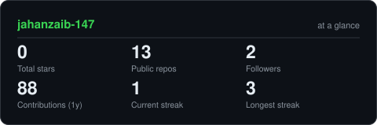

<div align="center">

<h1 align="center">Muhammad Jahanzaib</h1>

<!-- ANIMATED DOT-MATRIX PORTRAIT -->


<br>

<!-- ANIMATED CYBER TYPING TAGLINE -->
<a href="https://github.com/jahanzaib-147">
  
</a>

<br><br>

<!-- SOCIALS -->
<a href="https://linkedin.com"></a>
<a href="mailto:malikjahanzaibawan961@gmail.com"></a>
<a href="https://github.com/jahanzaib-147/ClientFolio-Commercial-Developer-Portfolio-WebApp"></a>

</div>

---

## `~/` whoami

```console
$ cat about.txt
```

Hi, I'm **Muhammad Jahanzaib**. I'm a Computer Science graduate (GPA 3.6 / 4.0, Iqra University) passionate about **Cybersecurity Operations (SOC)**, **Threat Detection & Incident Response**, and **Software Engineering**. I combine hands-on security operations using enterprise SIEM and EDR platforms with solid development skills in Python, JavaScript, and React.

- 🛡️ **Security Operations (SOC)**: Former SOC Analyst Intern at **Jubilee Life Insurance** — Triaged high-volume IBM QRadar SIEM/SOAR alerts, filtered true positives, investigated threat intelligence indicators, and executed endpoint containment using Trellix EPP & Carbon Black EDR.
- 💻 **Software & Security Development**: Built high-performance distributed simulation engines, automated security workflows in Python, and developed full-stack web applications with React and JavaScript.
- 🌐 **Network Defense & Architecture**: Designed robust perimeter security and multi-campus network topologies utilizing Cisco ASA stateful firewalls, dynamic OSPF routing, and Zero-Trust VLAN/DMZ segmentation.
- 📜 **Core Certifications**: **ISO/IEC 27001 Information Security Associate™** (SkillFront) & **Certified Threat Intelligence & Governance Analyst (CTIGA)** (Hack and Fix).

<br>

<div align="center">

## `~/` toolbox


<br><br>

<p align="center">
  
  
  
  
  
  
</p>

</div>

---

<div align="center">

## `~/` skill radar

<table>
<tr>
<td width="50%" align="center" valign="middle">

<!-- Systems & Security Radar Chart -->
<picture>
  <source media="(prefers-color-scheme: dark)"  srcset="assets/radar-dark.svg">
  <source media="(prefers-color-scheme: light)" srcset="assets/radar-light.svg">
  
</picture>

</td>
<td width="50%" align="center" valign="middle">

<!-- Live Language Mix Radar Chart (built from live GitHub language bytes) -->
<picture>
  <source media="(prefers-color-scheme: dark)"  srcset="assets/radar-langs-dark.svg">
  <source media="(prefers-color-scheme: light)" srcset="assets/radar-langs-light.svg">
  
</picture>

</td>
</tr>
</table>

</div>

---

<div align="center">

## `~/` the numbers

<!-- Generated Stat Card -->
<picture>
  <source media="(prefers-color-scheme: dark)"  srcset="assets/card-stats-dark.svg">
  <source media="(prefers-color-scheme: light)" srcset="assets/card-stats-light.svg">
  
</picture>

<br><br>


</div>

---

<div align="center">

<sub><em>"Bridging defensive security operations, threat triage, and modern software development."</em></sub>

</div>
